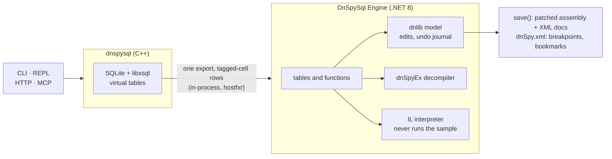

<div align="center">

# DnSpySql

**Query, patch and annotate .NET assemblies with SQL, using dnSpy's own engine.**

[](https://github.com/rkn47/dnspysql/actions/workflows/ci.yml)
[](LICENSE)


[Build](#build) · [Quick start](#quick-start) · [Usage](#usage) · [Schema](#schema) · [dnSpy hand-off](#handing-results-to-dnspy) · [Triage](#triage-and-protected-assemblies) · [How it works](#how-it-works)

</div>

DnSpySql loads assemblies with [dnlib](https://github.com/0xd4d/dnlib), decompiles them with
[dnSpyEx's decompiler](https://github.com/dnSpyEx/dnSpy) (a dnlib-backed fork of ILSpy), and exposes everything dnSpy
shows as SQLite virtual tables.

- **Everything dnSpy shows, as tables:** metadata, IL, cross-references and the analyzer, decompiled code with its
  line ↔ IL mapping, resources and BAML, PE headers and raw bytes, PDB data, and dnSpy's breakpoint configuration.
- **Triage:** tables name the protector, list capabilities, indicators and config values, and compute what string
  decryptors return without running the sample.
- **Edits:** `UPDATE`/`INSERT`/`DELETE` and functions change the live dnlib model, are journaled for
  `undo()`/`redo()`, and are written back with `save()`, preserving tokens.
- **dnSpy hand-off:** comments, bookmarks and breakpoints go to dnSpy; the output and its line numbers are dnSpy's.
- **Front ends:** a command-line tool, a REPL, an HTTP server, or an MCP server for AI agents, on Windows and Linux.

> [!NOTE]
> This project includes implementation work substantially informed by libxsql, idasql and ghidrasql by Elias
> Bachaalany: [libxsql](https://github.com/0xeb/libxsql) is its SQL layer, used unmodified, and the idea of querying a
> reverse-engineering database with SQL, with several of its conventions, comes from idasql and ghidrasql. No code is
> copied from them; DnSpySql was written with AI assistance, and is not affiliated with or endorsed by their author.
> Details and licenses are under [Credits](#credits-and-third-party-software).

```bash
dnspysql App.dll -c "SELECT full_name, method_count FROM types ORDER BY method_count DESC LIMIT 5"
dnspysql App.dll -c "SELECT caller_name FROM callers WHERE method = resolve('App.License::IsValid')"
dnspysql App.dll -c "SELECT text FROM pseudocode WHERE handle = resolve('App.License::IsValid')"
dnspysql App.dll -c "SELECT name, kind, confidence, evidence FROM protections"
dnspysql App.dll -c "SELECT set_body_stub(resolve('App.License::IsValid'), 1)" -c "SELECT save('App.patched.dll')"
dnspysql App.dll -c "SELECT bp_set(resolve('App.License::IsValid'))" -c "SELECT bp_export('C:/dnSpy/dnSpy.xml')"
```

> [!IMPORTANT]
> **Safety.** DnSpySql parses the files it loads and never runs them, nor anything decoded from them (`open_bytes`,
> `untamper`, `embedded_pes`). The IL interpreter behind `decryptor_calls`, `field_inits`, `emulate()` and `untamper()`
> computes results itself and never runs sample code: calls into the framework are limited to an allowlist of
> in-memory computation, and P/Invoke, files, the registry and the network stop it ([details](#the-il-interpreter)).
>
> It writes only:
> - the project file beside the first input, once you annotate (`--no-project` keeps annotations in memory);
> - the files you ask for (`save`, `export_project`, `bp_export`);
> - on Windows, dnSpy's settings file, when the breakpoints, bookmarks or other dnSpy state it keeps in step change
>   (`--dnspy-xml off` turns that off).
>
> Parsing hostile files is still attack surface: `dpq` runs each sample in its own container without network, as a
> non-root user, with a read-only root and the sample mounted read-only ([Docker](#docker)).

Because the decompiler reads the same live model as the tables, each assembly is parsed once and edits show up in
`decompile()` immediately. The output, and its line numbers, are dnSpy's, so a breakpoint chosen on a decompiled line
lands where dnSpy shows it; `bp_export()` writes it into `dnSpy.xml`, and `export_project()` runs dnSpy's own project
exporter.

## Contents

- [Build](#build)
  - [Docker](#docker)
  - [Tests](#tests)
- [Quick start](#quick-start)
- [Usage](#usage)
  - [Options](#options)
  - [Front ends](#front-ends)
- [Schema](#schema)
  - [Tables](#tables)
  - [Conventions](#conventions)
  - [Functions](#functions)
- [Handing results to dnSpy](#handing-results-to-dnspy)
  - [Breakpoints](#breakpoints)
    - [Kept in step with dnSpy](#kept-in-step-with-dnspy)
  - [Annotated assemblies for dnSpy](#annotated-assemblies-for-dnspy)
  - [Exporting a project](#exporting-a-project)
- [Triage and protected assemblies](#triage-and-protected-assemblies)
  - [Triage](#triage)
    - [The IL interpreter](#the-il-interpreter)
  - [Decompiling protected assemblies](#decompiling-protected-assemblies)
    - [Anti-tamper](#anti-tamper)
    - [Decrypted strings in the code](#decrypted-strings-in-the-code)
    - [The file's own bytes](#the-files-own-bytes)
    - [Decompiler robustness](#decompiler-robustness)
    - [Damaged headers, overlays and bundles](#damaged-headers-overlays-and-bundles)
- [How it works](#how-it-works)
- [Credits and third-party software](#credits-and-third-party-software)
- [Contributing](#contributing)
- [License](#license)

## Build

> Step by step, with checks and troubleshooting (also written for AI agents): **[INSTALL.md](INSTALL.md)**.

DnSpySql builds and runs on **Windows x64** and **Linux x64**. Both need CMake ≥ 3.20, Ninja and the .NET 8 SDK.

**Windows:** Visual Studio 2022 or later (Build Tools are enough) with the C++ workload:

```bat
git submodule update --init
git -C external/dnSpyEx submodule update --init --depth 1 ^
    Extensions/ILSpy.Decompiler/ICSharpCode.Decompiler Extensions/ILSpy.Decompiler/NRefactory
build.cmd
```

**Linux:** gcc or clang (e.g. `apt install build-essential cmake ninja-build`):

```bash
git submodule update --init
git -C external/dnSpyEx submodule update --init --depth 1 \
    Extensions/ILSpy.Decompiler/ICSharpCode.Decompiler Extensions/ILSpy.Decompiler/NRefactory
./build.sh
```

Only two of dnSpyEx's nested submodules are needed; `--recursive` would fetch many more. See
[engine/vendor/README.md](engine/vendor/README.md) for what is compiled and why.

**Output:** `build/dnspysql` (`dnspysql.exe` on Windows) plus the managed engine in `build/engine/`. Running it needs
the .NET 8 (or newer) runtime, found through `DOTNET_ROOT`, the system install or a per-user one
(`%USERPROFILE%\.dotnet` or `%LOCALAPPDATA%\Microsoft\dotnet` on Windows; `/usr/share/dotnet`, `/usr/lib/dotnet` or
`~/.dotnet` on Linux).

`edit_type`/`add_type` compile against the framework reference pack from the SDK when one is installed
(`packs/Microsoft.NETCore.App.Ref`), so patched assemblies reference `System.Runtime` like the original compiler
output. On a runtime-only machine they fall back to the runtime's own assemblies.

### Docker

No network inside the container; the sample is mounted read-only:

```bash
docker build -t dnspysql .
docker run --rm --network none -v "$PWD:/samples:ro" dnspysql /samples/app.dll -c "SELECT count(*) FROM types"
./dpq open app.dll          # sandboxed session per sample (uid 1000, read-only root, no capabilities)
./dpq q <id> "SELECT * FROM entry_points"
```

### Tests

After a build (`build.cmd` or `./build.sh`):

```bash
dotnet test tests/DnSpySql.Tests
```

The tests run the built binary end to end (set `DNSPYSQL` to test another build): the parity suite against
`tests/corpus/SampleTarget`, DnSpySql's cases against `tests/corpus/Sample`, and the CLI, REPL, HTTP, `--remote` and
MCP front ends.

## Quick start

`tests/corpus/Sample` is a small program the tests use: a few classes, an interface and a base class with overrides,
generics, events and an async method. Build it and query it (on Windows, `build\dnspysql.exe` and backslashes):

```bash
dotnet build tests/corpus/Sample
build/dnspysql tests/corpus/Sample/bin/Debug/net8.0/Sample.dll --no-project
```

That opens the REPL; `.tables` lists the tables, `.schema methods` the columns of one, and each statement ends with
`;`:

```sql
SELECT full_name, method_count FROM types ORDER BY method_count DESC LIMIT 5;
SELECT name, detail FROM analyze WHERE target = resolve('Sample.Square::Area') AND relation = 'method.virtual_used_by';
SELECT field_name, value FROM field_inits WHERE type_name = 'Sample.Defaults';
SELECT decompile(resolve('Sample.MemberCard::IsValid'));
```

`-c "SQL"` runs one statement and exits instead, and `--format json` gives machine-readable output.

> [!TIP]
> To use DnSpySql from an AI agent, register it as an MCP server
> ([INSTALL.md](INSTALL.md#5-connect-to-an-agent-harness-mcp)); the agent then loads samples with
> `SELECT open('path')`.

## Usage

```text
dnspysql [options] <assembly|module|exe>...
```

### Options

| option | what it does |
|---|---|
| `-c`, `--command SQL` | run SQL and exit (repeatable, runs in order) |
| `-f`, `--file PATH` | run a SQL script file (repeatable, runs in order with `-c`) |
| `-i`, `--interactive` | start the REPL (default when no `-c`/`-f`/`--http`/`--mcp`) |
| `--format FMT` | `table` \| `json` \| `jsonl` \| `csv` \| `tsv` (default `table`) |
| `--http [PORT]` | serve the HTTP API (default port 8081; 0 = any free port) |
| `--bind ADDR` | HTTP bind address (default 127.0.0.1; use 0.0.0.0 in containers) |
| `--token TOKEN` | require `Authorization: Bearer TOKEN` (or `X-XSQL-Token`) on HTTP |
| `--mcp` | serve the Model Context Protocol over stdio |
| `--remote URL` | send `-c`/`-f` SQL to a running DnSpySql HTTP server instead (uses `--token`, `--format`) |
| `--ref DIR` | extra directory with referenced assemblies (repeatable; e.g. .NET Framework refs on Linux) |
| `--readonly` | refuse every write (tables and functions) |
| `--project PATH` | annotation store (default: `<first input>.dnspysql.json`) |
| `--no-project` | keep annotations in memory only |
| `--dnspy-xml PATH` | dnSpy settings file kept in step with breakpoints/bookmarks: `auto` (default), `off`, or a path |
| `--timeout MS` | per-statement timeout |
| `--max-rows N` | row cap per statement for output (default 100000) |
| `--continue` | keep running statements after an error |
| `--schema-md` | print the schema reference (docs/SCHEMA.md) and exit |
| `--engine DIR` | directory holding `DnSpySql.Engine.dll` (default: `<exe dir>/engine`) |
| `--version` | print version and exit |
| `-h`, `--help` | this help |

### Front ends

| front end | details |
|---|---|
| **Output** | `json` is a script envelope (`success`, `statement_count`, `results[{columns, rows, row_count, changes, truncated, elapsed_ms, error}]`, ...); `table` output escapes invisible, bidi and private-use characters as `\uXXXX` so obfuscated names stay readable. |
| **REPL** | `.tables [pattern]`, `.schema [table]`, `.functions [pattern]`, `.mode`, `.modules`, `.open`, `.info`, `.undo [n]`, `.redo [n]`, `.save PATH [module]`, `.read FILE`, `.timeout MS`, `.http start [port] \| stop`. Statements end with `;`; Ctrl+C cancels the running statement. |
| **HTTP** | `POST /query` (raw SQL, or JSON `{sql, continue_on_error, include_sql, max_rows}`; `?format=json\|text\|csv\|tsv`), `GET /status`, `GET /health`, `GET /schema`, `POST /cancel`, `POST /shutdown`. |
| **MCP** | Tools `dnspysql_query`, `dnspysql_schema` and `dnspysql_guide` (and the older `sql` / `schema`); `ping` and `notifications/cancelled` are answered while a query runs. The workflow guides (`dnspysql_guides`: basics, explore, triage, unpack, dnspy) are also offered as MCP prompts, with the assembly to work on as an argument. |
| **Notices** | A statement that writes files beside a `save()` or updates `dnSpy.xml` reports it: `note:` on stderr (CLI, REPL), after the text result (MCP), or a `notice` field (JSON). |

From Claude Code, register either one server for every sample (the agent loads them with `SELECT open('path')`) or
one per sample; other clients are in [INSTALL.md](INSTALL.md#5-connect-to-an-agent-harness-mcp):

```bash
claude mcp add --scope user dnspysql -- /path/to/dnspysql --mcp
claude mcp add dnspysql -- /path/to/dnspysql /path/to/target.dll --mcp
```

## Schema

The full reference is generated from the code into [docs/SCHEMA.md](docs/SCHEMA.md); from SQL, query
`dnspysql_tables`, `dnspysql_columns` and `dnspysql_functions`. [docs/DNSPY_MAPPING.md](docs/DNSPY_MAPPING.md) maps
every dnSpy window and command to it.

### Tables

Every table and view, by area (104 in all; click an area to open it). *writes* lists what the table
accepts besides `SELECT`; edits are journaled (`undo()`/`redo()`) and refused with `--readonly`. Columns are in
[docs/SCHEMA.md](docs/SCHEMA.md).

<details>
<summary><b>Session and assembly</b> (16)</summary>

| table | writes | description |
|---|---|---|
| `asmrefs` | UPDATE | AssemblyRef rows: assemblies this module references |
| `assemblies` | UPDATE | AssemblyDef rows (identity of each loaded assembly) |
| `binary` |  | Key/value summary of the session's primary module (canonical keys) |
| `bundle_entries` |  | Files inside a .NET single-file bundle the module was opened from; `open_bundle_entry(path)` loads an embedded assembly |
| `dnspysql_columns` |  | Catalog of DnSpySql columns (tables and views) |
| `dnspysql_functions` |  | Catalog of DnSpySql SQL functions |
| `dnspysql_guides` |  | How to use DnSpySql, one guide per workflow (basics, explore, triage, unpack, dnspy); the MCP server offers them as prompts |
| `dnspysql_tables` |  | Catalog of DnSpySql tables and views |
| `exported_types` |  | ExportedType rows (type forwarders and multi-module exports) |
| `files` |  | File table rows (multi-file assembly members) |
| `modrefs` | UPDATE | ModuleRef rows (native DLLs and netmodules referenced) |
| `modules` | UPDATE | Loaded modules (one row per assembly/netmodule file) |
| `namespaces` |  | Namespaces per module with top-level type counts |
| `runtime_settings` | UPDATE | Session settings; UPDATE value on settable rows |
| `sql_capabilities` |  | Feature matrix of this build |
| `transactions` |  | Undo/redo journal of SQL writes. undo()/redo() replay it |

</details>

<details>
<summary><b>Metadata</b> (20)</summary>

| table | writes | description |
|---|---|---|
| `accessors` |  | Property/event accessor methods (MethodSemantics) |
| `api_docs` |  | XML documentation of a referenced type or member (dnSpy's tooltips) (needs `WHERE one of (member, doc_id) = ...`) |
| `custom_attributes` | INSERT, DELETE | Custom attributes on every owner (assembly, module, type, member, param, generic param, ...) |
| `decl_security` |  | DeclSecurity rows (CAS permission sets) |
| `events` | UPDATE, DELETE | EventDefs with accessor handles |
| `fields` | UPDATE, INSERT, DELETE | FieldDefs: type, flags, constants, RVA data; dnSpy 'Edit Field' surface |
| `generic_params` | UPDATE | Generic parameters of types and methods |
| `interfaces` | INSERT, DELETE | InterfaceImpl rows: interfaces implemented by each type |
| `memberrefs` |  | MemberRef rows: external (or generic-instance) methods and fields |
| `method_overrides` |  | MethodImpl rows: explicit interface implementations / .override |
| `methods` | UPDATE, INSERT, DELETE | MethodDefs: signature, flags, body summary; dnSpy 'Edit Method' surface |
| `methodspecs` |  | MethodSpec rows (generic method instantiations) |
| `params` | UPDATE | Parameters (seq 0 = return value, -1 = hidden this). Filter by method for speed |
| `pinvokes` | UPDATE | P/Invoke imports (ImplMap): native DLL + entry point per method |
| `properties` | UPDATE, DELETE | PropertyDefs with accessor handles |
| `standalonesigs` |  | StandAloneSig rows (local variable and calli signatures) |
| `typerefs` |  | TypeRef rows: external types referenced by the module |
| `types` | UPDATE, INSERT, DELETE | TypeDefs (including nested and &lt;Module&gt;); dnSpy 'Edit Type' surface |
| `typespecs` |  | TypeSpec rows (generic instances, arrays, pointers used as types) |
| `user_strings` |  | The `#US` heap: every `ldstr` literal of the module |

</details>

<details>
<summary><b>Code</b> (6)</summary>

| table | writes | description |
|---|---|---|
| `blocks` |  | Basic blocks of a method's IL. WHERE method = ... reads one body |
| `cfg_edges` |  | Control-flow edges between basic blocks. WHERE method = ... reads one body |
| `exception_handlers` | UPDATE, INSERT, DELETE | try/catch/finally/fault/filter regions of method bodies |
| `il` | UPDATE, INSERT, DELETE | IL instructions, one row per instruction. `WHERE method = ...` reads one body; without it every body is scanned |
| `literals` |  | Constant literals loaded by IL (ldc.*, ldstr): dnSpy literal search |
| `locals` | UPDATE, INSERT, DELETE | Local variables of a method body (names from the PDB). WHERE method = ... reads one body |

</details>

<details>
<summary><b>Cross-references and call graph</b> (12)</summary>

| table | writes | description |
|---|---|---|
| `analyze` |  | dnSpy's Analyzer as a table-valued function: every relation of `target`, optionally one `relation` (needs `WHERE target = ...`) |
| `call_edges` |  | Call graph edges (call, callvirt, newobj, ldftn, ldvirtftn, jmp). dst = 0 when the callee is external |
| `callers` |  | Who calls a method (`WHERE method = ...`), also through a base or interface method it overrides or implements (`via`) |
| `dispatch_calls` |  | Virtual calls that can reach a method through a base or interface method it overrides or implements (dnSpy's Virtual Used By) |
| `string_refs` |  | String literals with their referrers: ldstr in IL, string constants, string attribute arguments (dnSpy StringSearcher) |
| `xrefs` |  | Every IL reference: calls, field read/write/addr, type and token uses, ldstr. Filter on from_method, to_def or to_name. Bodies that are not IL (encrypted until runtime, see method_bodies) are left out: SELECT untamper() first |
| `callees` |  | *View.* What a method calls (`WHERE method = ...`); external callees have `callee = 0` |
| `entry_points` |  | *View.* Managed entry points, module initializers and static constructors of every module |
| `external_calls` |  | *View.* Calls leaving the loaded modules, grouped by target (imports-like view) |
| `method_metrics` |  | *View.* Per-method size/complexity/fan-in/fan-out/string counts for triage (hotness_score ranking) |
| `native_imports` |  | *View.* P/Invoke imports grouped by DLL |
| `type_hierarchy` |  | *View.* Direct base type and interfaces of every type |

</details>

<details>
<summary><b>Triage: protection, capabilities, indicators, configs</b> (11)</summary>

| table | writes | description |
|---|---|---|
| `capabilities` |  | What the code does, at the call or literal that shows it: injection, persistence, download and execute, keylogging, capture, credential theft and more |
| `carve_file` |  | PE files in any file's bytes, for a file `open()` refuses (a native dropper): `WHERE path = '...'`, then `open_bytes(data)` of a .NET one (needs `WHERE path = ...`) |
| `decoded_fields` |  | Settings as the program decrypts them at startup: a settings class's fields after the method that decodes them in place (key from another field), interpreted |
| `decryptor_calls` |  | Every call of a string decryptor with literal arguments (or settings fields of known value): what it decrypts, where to break, whether it is still ciphertext |
| `embedded_pes` |  | PE files inside a module: in its file bytes (overlay, sections), in resources and `.resources` entries, also compressed or split across numbered resources |
| `field_inits` |  | Constants constructors store in fields (where malware settings live): strings, numbers, byte and string arrays, also computed by a getter, decryptor or framework call |
| `iocs` |  | URLs, webhooks, Telegram tokens, IPs, domains, host:port pairs, e-mails, wallets, registry keys and mutex names in literals, base64 literals, decrypted strings, decoded settings and text resources |
| `protections` |  | Protectors (ConfuserEx, SmartAssembly, ...; decoy markers flagged) and protection techniques (anti-tamper, IL virtualization, a code-less stub, ...), with evidence |
| `split_text` |  | A text cut at a `separator` (default ','), one row per piece: configs are often one delimited string (needs `WHERE text = ...`) |
| `string_decryptors` |  | Methods shaped like a string decryptor, ranked by call sites with literal arguments |
| `text_iocs` |  | The indicators iocs finds, in any text: WHERE text = &lt;a decrypted config, a resource, a plaintext&gt;. Base64 inside it is decoded and searched too (needs `WHERE text = ...`) |

</details>

<details>
<summary><b>Decompiler</b> (4)</summary>

| table | writes | description |
|---|---|---|
| `baml` |  | BAML resources decompiled to XAML (WPF) |
| `pseudocode` |  | Decompiled source, one row per entity, in C#, VB or IL (`language`) (needs `WHERE handle = ...`) |
| `pseudocode_lines` |  | Decompiled source, one row per line with the IL offset of the statement starting on it (needs `WHERE handle = ...`) |
| `pseudocode_refs` |  | Names in the decompiled source and what they refer to (dnSpy's click-to-definition): members, locals, parameters, labels (needs `WHERE handle = ...`) |

</details>

<details>
<summary><b>Search</b> (2)</summary>

| table | writes | description |
|---|---|---|
| `jump_entities` |  | Every named entity (types, members, namespaces, resources) for quick lookup; filter with LIKE on name/full_name |
| `search` |  | dnSpy's search window, with optional `kind`, `match_mode` (contains, exact, word, regex) and `case_sensitive` (needs `WHERE query = ...`) |

</details>

<details>
<summary><b>Resources</b> (3)</summary>

| table | writes | description |
|---|---|---|
| `resource_elements` | UPDATE, INSERT, DELETE | Entries of `.resources` files: strings, primitives, byte arrays, serialized objects |
| `resource_images` |  | Images in resources, including serialized Bitmap/Icon/ImageListStreamer (read without deserializing); pixels via `image_pixels()` |
| `resources` | UPDATE, INSERT, DELETE | Manifest resources and their embedded bytes |

</details>

<details>
<summary><b>PE file and raw metadata</b> (13)</summary>

| table | writes | description |
|---|---|---|
| `byte_search` |  | Byte pattern search over the module files (`??` wildcards) (needs `WHERE pattern = ...`) |
| `debug_directories` |  | Debug directory entries (CodeView/PDB path, embedded PDB, checksum, deterministic) |
| `file_bytes` | UPDATE | Raw file bytes including patches; UPDATE patches like a hex editor (`save_raw`) |
| `file_map` |  | Every byte range of the file and what it is (dnSpy's hex view), with the gaps no structure accounts for; `WHERE contains = <offset>` |
| `heap_entries` |  | Entries of the `#Strings`, `#US`, `#Blob` and `#GUID` heaps, whether anything references them, and slack |
| `md_rows` | UPDATE | Raw metadata table cells (dnSpy's metadata table view); UPDATE patches the file (needs `WHERE table_name = ...`) |
| `md_streams` |  | Metadata stream headers (#~, #Strings, #US, #GUID, #Blob, #Pdb ...) |
| `md_tables` |  | Metadata tables present in #~ with row counts, row sizes and file offsets |
| `method_bodies` |  | Method bodies as they are in the file: tiny/fat/invalid header (or C++/CLI native code), exception sections, IL that does not decode, shared or overlapping bodies |
| `pe_data_directories` |  | The 16 optional-header data directories |
| `pe_fields` | UPDATE | Every field of the DOS, file, optional, COR20 and metadata headers, with its file offset; UPDATE patches the file |
| `pe_sections` |  | PE section headers |
| `win32_resources` |  | Native Win32 resources (version info, manifest, icons ...) |

</details>

<details>
<summary><b>Debug information (PDB)</b> (5)</summary>

| table | writes | description |
|---|---|---|
| `custom_debug_info` |  | Custom debug information (state machines, async info, source link, embedded source, dynamic locals, tuple names ...) |
| `pdb_documents` |  | Source documents referenced by the PDB |
| `pdb_locals` |  | Named locals and constants from PDB scopes |
| `pdb_scopes` |  | Local scopes per method (PDB) |
| `sequence_points` |  | IL offset to source line mapping from the PDB |

</details>

<details>
<summary><b>Annotations</b> (4)</summary>

| table | writes | description |
|---|---|---|
| `bookmarks` | UPDATE, INSERT, DELETE | Bookmarks (dnSpy's Bookmarks window); exported to dnSpy with the breakpoints |
| `comments` | UPDATE, INSERT, DELETE | Comments on entities or on IL offsets inside methods; `save()` writes them as XML documentation for dnSpy |
| `kv` | UPDATE, INSERT, DELETE | Persistent key/value store in the project file (agent notes, progress, settings) |
| `tags` | UPDATE, INSERT, DELETE | Tags on entities for triage/progress tracking |

</details>

<details>
<summary><b>Breakpoints for dnSpy</b> (4)</summary>

| table | writes | description |
|---|---|---|
| `breakpoints` | UPDATE, INSERT, DELETE | Code breakpoints and tracepoints: method + IL offset, condition, hit count, filter, trace message, labels |
| `exception_settings` | UPDATE, INSERT, DELETE | dnSpy Exception Settings: break on first/second chance per exception type, optional module conditions |
| `module_breakpoints` | UPDATE, INSERT, DELETE | dnSpy module breakpoints: break when a module matching module_name (wildcards) is loaded/unloaded |
| `throw_sites` |  | Every throw/rethrow in loaded code with the exception type when it is constructed just before (newobj ... throw) |

</details>

<details>
<summary><b>dnSpy's own state (dnSpy.xml)</b> (4)</summary>

| table | writes | description |
|---|---|---|
| `dnspy_debugger_settings` | UPDATE | dnSpy's debugger options, including its anti-anti-debug protections; UPDATE value to set one |
| `dnspy_documents` | INSERT, DELETE | The assemblies dnSpy opens at startup; `save()` adds the annotated copy |
| `dnspy_tabs` |  | The tabs dnSpy showed when it last exited, resolved to handles |
| `dnspy_watch` | UPDATE, INSERT, DELETE | Expressions in dnSpy's Watch windows; INSERT adds one for the next debugging session |

</details>

### Conventions

- **Handles.** Every entity has a `handle` = `module << 32 | metadata token` (`0x1_06000005`); foreign keys
  (`method`, `type`, `owner`, ...) hold handles. Bare tokens and `'0x..'` text, including `tok()`'s
  `'0x1_06000005'`, are accepted everywhere; bare tokens resolve against the current module (`use_module(id)`).
- **Names.** `resolve('Ns.Type::Member')` returns a handle; an overloaded method is named with its parameter types
  (`'Ns.Type::Load(System.String)'`), and without them `resolve()` returns the first overload with a note. It
  searches the current module first; a name in several modules (an `untamper()` copy, a stage opened twice) gets a
  note, and `resolve(name, kind, module)` picks one.
- **Modules.** `modules.origin` says how a module was opened (`file`, `bundle`, `bytes`, `untamper`) and
  `derived_from` which module it came out of. `close(id)` takes a module out of the session with everything that came
  out of it and frees their memory; a long session should close each sample when it is done with it. Module ids are
  never reused, so a handle into a closed module is an error, not another module's entity.
- **Call graphs.** `callers` also lists the calls that can reach a method through a base or interface method it
  overrides or implements (`via` = `virtual` or `interface`), since such a call site names that slot; `call_edges`
  and `xrefs` keep the reference as the IL has it.
- **Required filters.** Tables computed from an argument need that filter and say which:
  `pseudocode WHERE handle = ...`, `search WHERE query = ...`, `md_rows WHERE table_name = ...`. `il`, `locals`,
  `exception_handlers`, `blocks` and `cfg_edges` take a `method` filter but also scan every body.
- **Undo.** Writes are journaled per statement: `undo(n)`, `redo(n)`, the `transactions` table; `--readonly`
  refuses them. `set_setting('read_only', 1)` locks a running session the same way; it cannot be switched off again.
- **Compatibility.** The names of earlier DnSpySql versions still work: `refs` and `attributes` are views, and older
  column names (`method_token`, `type_token`, `il_size`, ...) are extra columns. `params.seq` is now the ECMA
  sequence number (0 = return value); the 0-based argument position is `params.arg_index`.

### Functions

By area; signatures are in [docs/SCHEMA.md](docs/SCHEMA.md).

| area | functions |
|---|---|
| handles and names | `resolve`, `handle`, `token_of`, `module_of`, `kind_of`, `name_of`, `def_of`, `tok`, `hx`, `token_name`, `use_module` |
| session | `open`, `open_bytes` (a decoded payload as a module, named from its hash; bytes already open return that module; a native PE gives NULL and a note), `open_bundle_entry` (an assembly inside a single-file bundle), `untamper` (anti-tampered bodies, decrypted statically), `close` (a module and the stages that came out of it, freeing their memory), `close_all`, `save`, `save_raw`, `save_project`, `undo`, `redo`, `is_dirty`, `set_setting` |
| decompiler | `decompile`, `il_text`, `decompile_module`, `export_project`, `api_doc` (dnSpy's tooltip text) |
| raw bytes | `read_bytes`, `patch_bytes`, `method_bytes`, `rva_to_offset`, `offset_to_rva` |
| editing | `set_body_stub` (= `stub_return`), `il_set`, `il_insert`, `il_remove`, `il_nop`, `il_invert_branch`, `il_skip_branch`, `il_to_unconditional`, `il_optimize`, `il_simplify`, `replace_string`, `inline_strings` (decrypted strings into the code, or as comments), `rename_namespace`, `delete_namespace`, `import_member`, `add_reference_type`, `strip_strong_name`, `set_assembly`, `add_resource`, `set_resource_data`, `resource_set_empty` |
| C# compiler | `compile_method`, `add_members`, `add_type`, `edit_type`, `compile_preview` |
| annotations | `set_comment`, `tag` |
| triage | `triage` (the first look at a module as one JSON object: protections, payloads, decrypted strings, capabilities, indicators, config candidates, next queries) |
| breakpoints | `bp_set`, `bp_trace`, `bp_set_line`, `bp_set_decompiled`, `bp_toggle`, `bp_enable`, `bp_clear`, `bp_module`, `break_on_exception`, `bp_patch`, `bp_export` (= `export_dnspy_breakpoints`), `bp_import` (= `import_dnspy_breakpoints`), `dnspy_sync` |
| data | `regexp`, `regexp_extract`, `regexp_replace`, `base64_decode`, `base64_encode`, `text_decode`, `text_encode`, `xor`, `concat_bytes`, `int_at` (little/big-endian integers in a blob), `emulate` (a static method on literal arguments, interpreted), `decompress` (gzip, zlib, deflate, brotli, LZMA; detects gzip and zlib, also after a 4-byte length), `decrypt` (AES/DES/3DES/RC2/RC4), `try_decrypt` (NULL instead of an error, for trial decryption over many values), `aes_decrypt`, `pbkdf2`, `md5`, `sha1`, `sha256`, `entropy`, `image_pixels` (PNG/BMP/ICO pixels, for payloads hidden in images) |

## Handing results to dnSpy

### Breakpoints

DnSpySql is not a debugger and never runs the code it loads. You choose breakpoint locations with SQL (IL offset, PDB
source line, or a line of the decompiled C#) and hand them to a debugger in one of two ways.

**`bp_patch()` + `save()`** writes `if (Debugger.IsAttached) Debugger.Break();` in front of each breakpoint's
instruction. Jumps and exception-handler boundaries that pointed at that instruction now point at the check. The
patched assembly runs as before, but any debugger (dnSpy, Visual Studio, Rider, VS Code) stops there. Breakpoints with
a condition, hit count, filter or trace message can't be expressed this way, so `bp_patch` refuses them.

**`bp_export(path)`** hands them to dnSpy, with the condition, hit count, filter, tracepoint and labels, plus the
bookmarks, module breakpoints and exception settings:

- Given dnSpy's own settings file, it merges into it: an entry at the same location as one of DnSpySql's is replaced,
  and everything else, including breakpoints and bookmarks set in dnSpy, is kept. Close dnSpy first, since it
  rewrites `dnSpy.xml` when it exits; where the file is: [Kept in step with dnSpy](#kept-in-step-with-dnspy).
- Given a new path, it writes a file that dnSpy loads from Breakpoints window > Import (and Bookmarks window >
  Import).

A bookmark becomes a dnSpy bookmark on its IL offset, or on the type or member itself when it has none. dnSpy has no
bookmark comment, so the comment follows the name after ` — ` (split again by `bp_import`), and the category becomes
its labels.

dnSpy matches a breakpoint to a module by full file path. When dnSpy will open the assembly somewhere else (exported
on Linux, debugged on Windows), pass that directory as `module_dir`, or set `dnspy_module` per breakpoint.
`bp_import(path)` reads either kind of file back, including ones dnSpy wrote.

```sql
SELECT bp_set(method, offset) FROM il WHERE method = resolve('App.License::Check') AND opcode = 'call';
SELECT bp_set_decompiled(resolve('App.License'), 42, 'key.Length > 3');
UPDATE breakpoints SET hit_count = 3, hit_count_kind = 'MultipleOf' WHERE id = 1;
SELECT bp_module('payload*.dll'), break_on_exception('System.Security.Cryptography.CryptographicException');
INSERT INTO bookmarks (handle, offset, name, category, comment) VALUES (resolve('App.License::Check'), 0, 'check', 'license', 'returns the flag');
SELECT bp_export('C:/Users/me/AppData/Roaming/dnSpy/dnSpy.xml', NULL, 'C:/samples');
```

Breakpoints, like comments, bookmarks and tags, are kept in the project file (`<input>.dnspysql.json`).

#### Kept in step with dnSpy

On Windows the session also keeps dnSpy's own settings file up to date. After any statement that changes
breakpoints, bookmarks, module breakpoints, exception settings, debugger options (`dnspy_debugger_settings`), Watch
expressions (`dnspy_watch`) or the files dnSpy opens (`dnspy_documents`), they are merged into it, as `bp_export`
does. Those tables also show what dnSpy already has, and `dnspy_tabs` shows the tabs it last had open. An export also
takes back what an earlier export to the same file wrote and that is gone now (a deleted breakpoint, or entries at a
module's old path).

The runtime setting `dnspy_xml` (CLI `--dnspy-xml`, environment `DNSPYSQL_DNSPY_XML`) picks the file:

| value | file |
|---|---|
| `auto` (default) | dnSpyEx's own choice: `bin\dnSpy.xml` of a running dnSpy when that file exists, else `%APPDATA%\dnSpy\dnSpy.xml`. A portable dnSpy that is not running needs the path. |
| `off` | syncing is off |
| any other value | the path of the file |

> [!WARNING]
> dnSpy reads the file at startup and overwrites it when it exits. When dnSpy is running, the notice says so; close
> it, run `SELECT dnspy_sync()`, and start it again.

### Annotated assemblies for dnSpy

`save(path)` writes the edited assembly (renames included) and, beside it, what dnSpy needs to show the analysis
(turn this off with the `save_sidecars` setting):

- `<path without extension>.xml`, an XML documentation file. dnSpyEx loads it from next to the assembly and shows it
  as `///` comments:
  - a comment on a type, member or parameter becomes its `<summary>` or `<param>`;
  - comments at IL offsets are listed in the method's `<remarks>`, each with the decompiled statement;
  - tags close the `<remarks>`.
- `<path>.dnspysql.json`, the module's annotations, so a later session on the new file keeps them.

Tokens and the MVID are preserved, so breakpoints and bookmarks carry over. From then on they are exported for the
saved file, which is the one dnSpy opens, rather than the original sample, and the saved file is added to the files
dnSpy opens at startup (`dnspy_documents`).

```sql
SELECT set_comment(resolve('App.Crypto::Decrypt'), 'config decryptor: AES-ECB, key = md5(Mutex)');
SELECT set_comment(resolve('App.Program::Main'), 184, 'all Settings.* are plaintext here');
UPDATE types SET name = 'C2Client' WHERE handle = resolve('a.b');
SELECT bp_set_decompiled(resolve('App.Program::Main'), 21);
SELECT save('C:/cases/sample/sample.annotated.exe');   -- + sample.annotated.xml, dnSpy.xml updated
```

What dnSpy then shows:

```csharp
/// <summary>
/// config decryptor: AES-ECB, key = md5(Mutex)
/// </summary>
public static object Decrypt(string input)
```

### Exporting a project

`export_project(dir)` runs dnSpy's own project exporter (File > Export to Project) with the dialog's defaults: a
solution with one C# project per loaded module, resources unpacked and turned into `.resx` files, VS2010-format
projects (`export_project(dir, NULL, 1)` writes SDK-style ones). Types are decompiled with the same time budget and
per-method fallback as `decompile()`, so a hostile method costs only its own body. File names are made valid on
Windows even when exporting on Linux, since obfuscated names are full of characters Windows rejects. Like dnSpy's
export, the result is for reading and editing; code that uses newer C# features may need fixes before it compiles.

```sql
SELECT export_project('/cases/sample42/src');
```

## Triage and protected assemblies

### Triage

These tables answer the first questions about a sample without a page of joins over `il` and `xrefs`. Every row
points at the IL (or the bytes) that show it, so `decompile()`, `bp_set(method, offset)` and `set_comment` take it
from there.

| table | what it finds |
|---|---|
| `field_inits` | The constants constructors store in fields (strings, numbers, byte arrays from field data, string arrays), and values computed from constants: a getter's, or a decryptor's result, interpreted (`source`). Malware settings classes are filled this way, so the host, port, mutex and key are usually one query away. `is_default` marks the compiler's stores of 0, false and "" for fields with an explicit initializer. |
| `capabilities` | What the code does, at the call or string that shows it: process injection and hollowing, persistence, download and execute, in-memory loading, keylogging, screen capture, webcam and audio capture, credential theft, defense tampering, recovery inhibition, UAC bypass, hosts-file tampering, removable-drive spreading, shellcode execution, single instance, self-deletion, and network use (`SELECT DISTINCT kind FROM capabilities` lists what a sample has). APIs looked up by name (`GetProcAddress`, `GetMethod`) count too, and a call made through a proxy (a static method that only passes its arguments on, which obfuscators put in front of every API) is reported where the proxy is called. Call graphs (`callers`, `xrefs`) link an async method or iterator to its state machine's `MoveNext` (`kind = 'async'`), so a capability found there leads back to the method that started it. |
| `iocs` | URLs, Discord webhooks, Telegram bots and tokens, IP addresses, domains, e-mail addresses, wallets, registry keys and mutex names in string literals, in base64 literals that decode to text, in what the string decryptors return (`source = 'decrypted'`), and in text resources and `.resources` strings (`source = 'resource'`, with the `resource`); a mutex name is the value handed to the `Mutex` constructor, also when it comes from a settings field or a decryptor (`source = 'computed'`), and a name that is still ciphertext says so (`source = 'encrypted'`). Settings decoded at startup are searched too (`source = 'decoded'`), and a settings class's host field and port field give `host:port` pairs (`fields` names both). `is_library` marks hits in well-known library code. |
| `decoded_fields` | Settings the program decrypts at startup: a class whose static constructor stores string literals (usually ciphertext) and a parameterless static method that reads them and writes them back through a call, often with a key derived from another field (`Host = Decrypt(Host)`). The decoder is interpreted after the static constructor, and each field it changed has a row with its `initial` and decoded `value`; `error` says why a decoder stopped. Nothing here names a family: it is the shape settings code has. |
| `embedded_pes` | Every PE a module carries: anywhere in its file bytes (the overlay, a section) and in resources or `.resources` entries, also behind gzip, zlib or deflate (Costura's compressed references, a loader's payload). The size comes from the PE headers, so `SELECT open_bytes(data) FROM embedded_pes WHERE is_dotnet` opens each next stage, named from its hash; a native one has its `machine` and `kind` (open_bytes leaves it out with a note). A PE stored in pieces across numbered resources or `.resources` entries (`part1`..`part3`, `chunk_00.bin`, ...) is put back together: the pieces joined in order or reversed, as bytes or as base64 text (also reversed), plain or compressed; `location` says which pieces and how they were joined. |
| `decryptor_calls` | Every call of a string decryptor (`string_decryptors`, or any method with `WHERE decryptor =`) with literal arguments (also a static field of known value: a constant, what a decryptor computed into it, or its `decoded_fields` value, so `Decode(Config.Host)` is interpreted; `args_from = 'field'`), typed in `arg0`..`arg3`, and its `plaintext`: computed by interpreting the decryptor's IL (`emulation` says why when it cannot be). `plaintext_kind = 'ciphertext'` marks a plaintext that is base64 of more ciphertext, a second layer another method decrypts. `emulate(method, args...)` does the same for any static method. |

`SELECT triage()` (or `triage(module)`) puts these together as one JSON object, the first look at a sample in one
call: its identity and anomalies, protections, embedded PEs, string decryptors with the plaintexts of up to 200 call
sites, capabilities by kind, indicators, config candidates grouped by type, resources, and the queries to run next.
Library code is left out, and each list says how many entries it had.

```sql
SELECT field_name, value FROM field_inits WHERE kind IN ('string', 'int') AND type_name LIKE '%Settings%';
SELECT kind, api, method_name, offset FROM capabilities WHERE NOT is_library ORDER BY kind;
SELECT kind, value, source FROM iocs WHERE NOT is_library;
SELECT kind, value FROM text_iocs WHERE text = (SELECT plaintext FROM decryptor_calls LIMIT 1);
SELECT idx, value FROM split_text WHERE text = 'host|port|mutex' AND separator = '|';
SELECT caller_name, offset, args, plaintext FROM decryptor_calls WHERE emulation = 'ok';
SELECT field_name, value, decoder_name FROM decoded_fields WHERE field IS NOT NULL;
SELECT emulate(resolve('App.Strings::Decode'), 'cGF5bG9hZA==');
```

#### The IL interpreter

The interpreter never runs the sample. It reads IL and computes the result itself:

- **Calls into the sample** are interpreted the same way, including static constructors, struct-based decompressors
  and lambdas passed to LINQ. The module initializer runs first, as in the CLR, and a thread the code starts is not
  run. Pointers reach the module's own image (what anti-tamper routines decrypt) and `stackalloc` memory.
- **Calls into the framework** are made only for an allowlist of types that compute on data in memory: strings,
  encodings, conversions, arrays, hashes and ciphers, in-memory and compression streams. VB's late-bound calls
  (`obj.Name(args)` on an `Object`) are bound by name the same way, and `typeof(T)` answers what generic code asks of
  it (element type, `Array.CreateInstance`).
- **Reflection** over the code's own metadata (`GetMethod`, `Invoke`, `CreateDelegate`, `FieldInfo.SetValue`, tokens
  resolved through the module) works on descriptions, never on real `MethodInfo`s: an invoked sample method is
  interpreted, a framework one goes through the allowlist.
- **Data:** the sample's own resources are read from the file; machine-specific values come back as placeholders
  (`%TEMP%\`, `%USERNAME%`). An assembly the code loads from bytes is parsed, never run; its methods are interpreted
  when the code calls them. LZMA streams are decoded natively rather than through the sample's own decoder;
  `decompress(data, 'lzma')` does the same in SQL.
- **What stops it:** anything else, such as P/Invoke, the registry or the network, stops the emulation with the
  reason, as does a body that is still encrypted in the file and a random or time-dependent value (the result would
  differ on every run).

On a corpus of 210 .NET malware samples it computes 98% of the decryptor call sites (19,301 of 19,722), and every one
of them in 74 samples.

### Decompiling protected assemblies

Start with what protected it. `protections` names the protector from its marker types (ConfuserEx, SmartAssembly,
Babel, Dotfuscator, Agile.NET, Goliath, Costura) and flags markers planted in the wrong namespace as decoys. It also
lists the techniques it finds, each with a confidence and the evidence: renamed members, anti-tamper (bodies that are
encrypted until runtime), anti-debug and anti-VM checks, string encryption, control-flow flattening, proxy calls, IL
virtualization (methods that only hand an id and their arguments to one dispatcher, whose code is VM bytecode; their
`decompile()` says so), a stub assembly with no method body (its code is in what it carries, or an encrypted
section), and encrypted or embedded resources. Methods of a C++/CLI image are native code, not encrypted bodies.
`string_decryptors` ranks the methods shaped like a string decryptor: static,
returning a string, and called from many sites with literal arguments. Breakpoints on one show the plaintext in
dnSpy.

```sql
SELECT name, kind, confidence, evidence FROM protections;
SELECT method_name, call_sites, constant_sites, sample_args FROM string_decryptors ORDER BY score DESC LIMIT 5;
```

#### Anti-tamper

Anti-tamper keeps method bodies encrypted in the file until a startup routine decrypts them in memory, so the
decompiler and every table above see garbage. `untamper()` interprets that routine over a copy of the image
(`GetHINSTANCE` points into the copy, `VirtualProtect` and anti-debug checks are answered, nothing runs) and opens the
result as a new module, on which everything works, string decryption included:

```sql
SELECT untamper();                                         -- returns the new module's id, say 2
SELECT plaintext FROM decryptor_calls WHERE module = 2 AND emulation = 'ok';
SELECT kind, value FROM iocs WHERE module = 2 AND NOT is_library;
SELECT inline_strings(2);                                  -- the plaintexts as ldstr in the code (undoable)
SELECT save(2, 'C:/work/sample.untampered.exe');           -- a readable copy for dnSpy
```

It decrypts 33 of the 37 anti-tampered samples in that corpus, typically in about 3 seconds; the others use a
different scheme or stop the interpreter, and say why. A module whose bodies all decode is refused (nothing to
untamper) unless the initializer is passed, and when bodies still do not decode afterwards a note says how many. The
copy is marked (`modules.origin = 'untamper'`, `derived_from`), so `protections` and `triage()` on it do not suggest
`untamper()` again, and the interpreter does not run the decryption routine a second time when the copy's static
constructor calls it.

#### Decrypted strings in the code

`inline_strings([module [, decryptor [, mode]]])` replaces every call site that `decryptor_calls` interprets to a
string with `ldstr` of the plaintext; its literal arguments become nops. A site that code jumps into (flattened control
flow, where other paths pass other arguments) is left as it is, with a note. It is one undoable step, and the
decompiled code and a saved copy then show the strings. With `mode = 'both'` such a site gets the plaintext as a
comment instead, and `'comment'` comments every site and leaves the code alone; `save()` writes the comments for dnSpy.

#### The file's own bytes

Some tables read the file's own bytes, the way dnSpy's hex view does, so packing, encryption and stego show up even
where the decompiler only sees garbage:

| table | what it shows |
|---|---|
| `method_bodies` | each body's header (tiny, fat or invalid), exception sections, whether the IL decodes, and bodies that share or overlap another; anti-tamper protectors leave hundreds of invalid bodies |
| `file_map` | what every byte range is, and the gaps no structure accounts for, with their entropy |
| `heap_entries` | metadata heap entries nothing references, and slack after the last one |
| `resource_images`, `image_pixels()` | images in resources (serialized bitmaps included, read without deserializing) and their raw pixels, where loaders hide the next stage |

```sql
SELECT format, il_status, count(*) FROM method_bodies GROUP BY 1, 2;
SELECT path, size, entropy FROM file_map WHERE kind = 'gap' AND NOT all_zero ORDER BY size DESC;
SELECT element, width, height, hex(substr(image_pixels(data, 'rgb'), 1, 4)) FROM resource_images;
```

#### Decompiler robustness

The decompiler reads the dnlib model, so it handles metadata that a `System.Reflection.Metadata` reader rejects —
including control-flow-flattened code and zero-width-Unicode names. Even so, `decompile`, `decompile_module` and
`il_text` never abort a query: a failure comes back as a C# comment starting `/* dnspysql: `, so a bulk query returns
a row per entity and you can find the gaps with SQL.

```sql
SELECT count(*) total,
       sum(CASE WHEN decompile(handle) LIKE '/* dnspysql:%' THEN 1 ELSE 0 END) failed
FROM types;
```

- **Whole modules.** `decompile_module` is assembled type by type, so one unreadable type costs only its own body: it
  is annotated in place and the output ends with a count of what was incomplete. Types come from the same
  per-session cache as `decompile()`, and under a statement timeout it stops between types with a note rather than
  losing everything: running it again goes on from where it stopped. A token of the wrong kind is still a hard
  error, since that is a query bug rather than a damaged assembly.
- **Bad methods.** Within a type, one bad method costs only itself. The ILSpy v2-era engine can loop forever on some
  obfuscated control flow, so each decompile has a time budget (20 s per method; a whole type gets that plus 1 s per
  method body). When a type fails or runs out of budget, its methods are tried one by one and the type is decompiled
  again with the culprits' bodies left empty, each named in a leading `// dnspysql:` comment that points to
  `il_text()`.
- **Caching.** `decompile()` and `pseudocode` results are cached until the module is next edited, so a query that
  uses the same result several times decompiles it once.

#### Damaged headers, overlays and bundles

- **Wiped headers.** Some samples destroy the CLI header while the metadata itself is intact, and native-stub
  protectors also wipe the metadata root's `BSJB` signature and stream names (restoring them in memory at startup).
  When a file fails to load for that reason, DnSpySql finds the metadata root (by its signature or its runtime
  version string), names its streams by their content, drops decoy streams, rebuilds the header in memory, and
  records what it did in `modules.repair` and `binary.anomalies`. Managed resources and a valid entry point are kept
  from the old header; otherwise the entry point is unknown.
- **Overlays.** Data appended after the PE image is described in the `modules` table: `overlay` summarizes it, and
  `overlay_offset`, `overlay_size`, `overlay_entropy`, `overlay_kind`, `overlay_pe_offset` and `overlay_padding`
  break it down. .NET compilers never emit an overlay, so one is usually a dropper's payload, a second PE, an
  encrypted config, or zero padding that inflates the file past scanners' size limits. An Authenticode certificate
  table is not counted. `SELECT read_bytes(overlay_offset, overlay_size) FROM modules WHERE overlay_size > 0` returns
  the data itself.
- **Single-file apps.** A .NET single-file app (`PublishSingleFile`: framework-dependent, self-contained or
  compressed) opens from its app host, Windows PE or Linux ELF. DnSpySql reads the bundle manifest, loads the app's
  own assembly as the module, and lists everything the host carries in `bundle_entries` (path, kind, offset, size,
  compressed size). `SELECT open_bundle_entry('Lib.dll')` loads another embedded assembly as a further module; the
  bundled runtime's own assemblies are left to the shared framework.
- **Framework references** are resolved the way dnSpy resolves them: the assembly's own directory, then the .NET
  Framework (the GAC on Windows; on Linux the reference assemblies `build.sh` bundles, or Mono's), then the .NET
  shared frameworks of the runtime DnSpySql runs on. Decompiler transforms such as `async`/`await` reconstruction
  need those types, so without them a .NET (Core) assembly would show raw compiler state machines.

`SELECT value FROM binary WHERE key = 'anomalies'` lists everything above that looks like a protector or packer: wiped
headers, decoy or renamed metadata streams, encrypted bodies, high-entropy sections, invisible names, anti-tamper
imports and overlays.

> [!CAUTION]
> Files next to a sample are input too. dnSpy's decompiler and `api_docs` read the XML documentation next to an
> assembly, and dnSpyEx follows a `redirect` in it to any path, including a network share, which would send the
> analyst's credentials to whoever planted it. DnSpySql ignores a neighbouring `.xml` that redirects to a rooted path
> or declares a DTD; the documentation then comes from the reference packs, or there is none. Likewise a reference
> whose name is a path (`\\host\share\x`, `..\x`) is never resolved, since the resolver would probe it as a file.

## How it works



`dnspysql` (C++) hosts the .NET runtime in-process through `hostfxr` and calls a single exported entry point in
`DnSpySql.Engine.dll`. The engine owns the schema: tables are `Table<T>` definitions (column lambdas over dnlib
objects, with pushdown, required filters, `INSERT`, `UPDATE`, `DELETE` and undo), described to the native side at
startup, which registers each one with SQLite as a libxsql generator table. Rows cross the boundary in a small tagged
binary format (`engine/DnSpySql.Engine/Wire.cs`); adding a table needs no native change. A text value that contains a
NUL character (a decrypted string can) comes back as a blob of its UTF-8 bytes, since libxsql's text results end at
the first NUL.

The boundary is the cost, so it is crossed as little as possible:

- **Batched cursors.** Scans are cursors read in batches that grow from 64 rows to 16,384, so `LIMIT` stops early; the
  first batch comes back with the cursor, so a point lookup (one probe of a join) is one call.
- **Only the columns used.** The engine computes only the columns a query reads (SQLite's `colUsed`), and a bare
  `count(*)` is answered without building rows.
- **Pushdown.** Equality filters on the indexed columns (and range filters on `il.idx` and byte offsets) reach the
  engine (libxsql constraint filters, one per filterable column, costed by selectivity), which applies them all
  itself; handle filters are resolved directly. `dnspysql_columns.pushdown` says which columns these are.
- **Fast start.** The engine is compiled ahead of time (ReadyToRun), so a process starts in about 0.2 s.

Statement timeouts and Ctrl+C stop SQLite (progress handler), libxsql's table loops and the engine's own work (scans,
the decompiler) together. Measurements are in [docs/BENCHMARKS.md](docs/BENCHMARKS.md).

## Credits and third-party software

- **libxsql** by Elias Bachaalany (https://github.com/0xeb/libxsql) is an unmodified library dependency under the
  Human-Origin Source License v1.0; DnSpySql does not copy, modify or port its code.
- **dnSpyEx** (https://github.com/dnSpyEx/dnSpy) is vendored as the git submodule `external/dnSpyEx`, used
  unmodified, for its dnlib-backed decompiler, its project exporter and its BAML decompiler. It is licensed under the
  **GPL, version 3 or later**, which is why DnSpySql is GPL-licensed too.

[THIRD_PARTY_NOTICES.md](THIRD_PARTY_NOTICES.md) lists every component and its license, which dnSpyEx sources are
compiled, and what the AI that helped write DnSpySql read of the projects credited at the top of this README.

## Contributing

Issues and pull requests are welcome. Before you start:

- [INSTALL.md](INSTALL.md) builds it, and [How it works](#how-it-works) describes the design: all schema lives in the
  managed engine (`engine/DnSpySql.Engine/Tables` and `Functions`), so a new table or function needs no native
  change.
- Tests run the built binary end to end on the benign assemblies in `tests/corpus`. A change in behaviour comes with
  a test, and `dotnet test tests/DnSpySql.Tests` passes.
- Never commit samples, and never let a test or a tool run a loaded assembly.
- A schema change regenerates `docs/SCHEMA.md` (the build does it) and the table list in this README
  (`python tools/docs/readme_tables.py --exe build/dnspysql`); existing table, column and function names keep
  working.
- DnSpySql stays generic: tables, file formats and the interpreter's CLR semantics, not a deobfuscator for one
  protector or a config extractor for one malware family. Naming a protector in `protections` is identification and
  is fine.
- New source files start with the license header the existing ones carry, and contributions are under the same
  license (below).

## License

DnSpySql — Copyright (C) 2026 Rakan Alduwaysan — is licensed under the GNU GPL, version 3 only ([LICENSE](LICENSE)),
with the additional terms that section 7 of the GPL permits ([NOTICE](NOTICE)): keep the author attribution, do not
misrepresent the origin, mark modified versions as modified, and do not use the DnSpySql name or the author's name to
promote derived works. Third-party components keep their own licenses
([THIRD_PARTY_NOTICES.md](THIRD_PARTY_NOTICES.md)).

> [!IMPORTANT]
> This repository is source only. A build runs dnSpyEx's GPL code and libxsql, whose license is not the GPL, in one
> process: [NOTICE](NOTICE) gives the additional permission that lets DnSpySql's own code be combined with libxsql,
> but dnSpyEx's license has no such permission, so build DnSpySql for your own use and do not hand out binaries or
> images built from it until that is resolved ([THIRD_PARTY_NOTICES.md, Binaries](THIRD_PARTY_NOTICES.md#binaries)).
